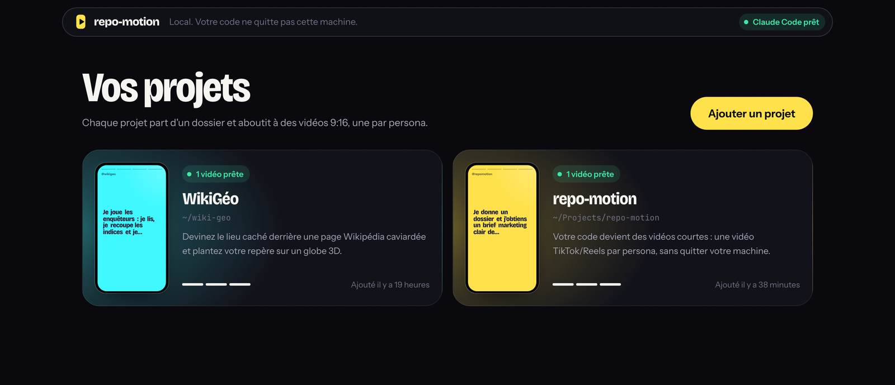
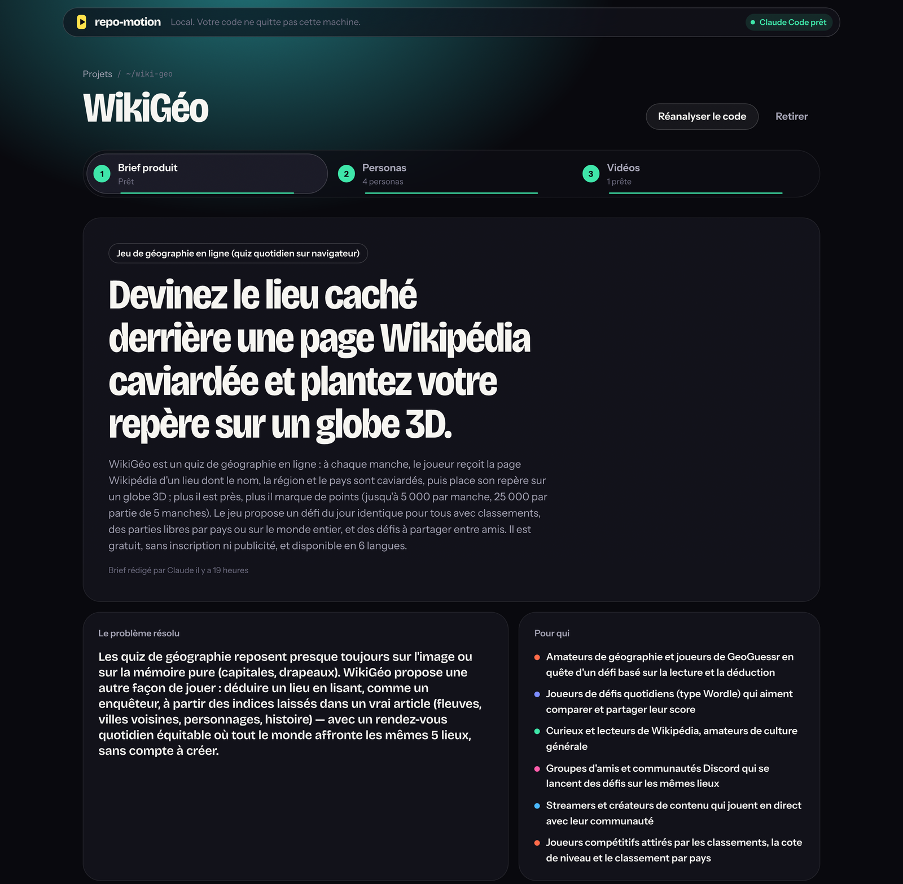
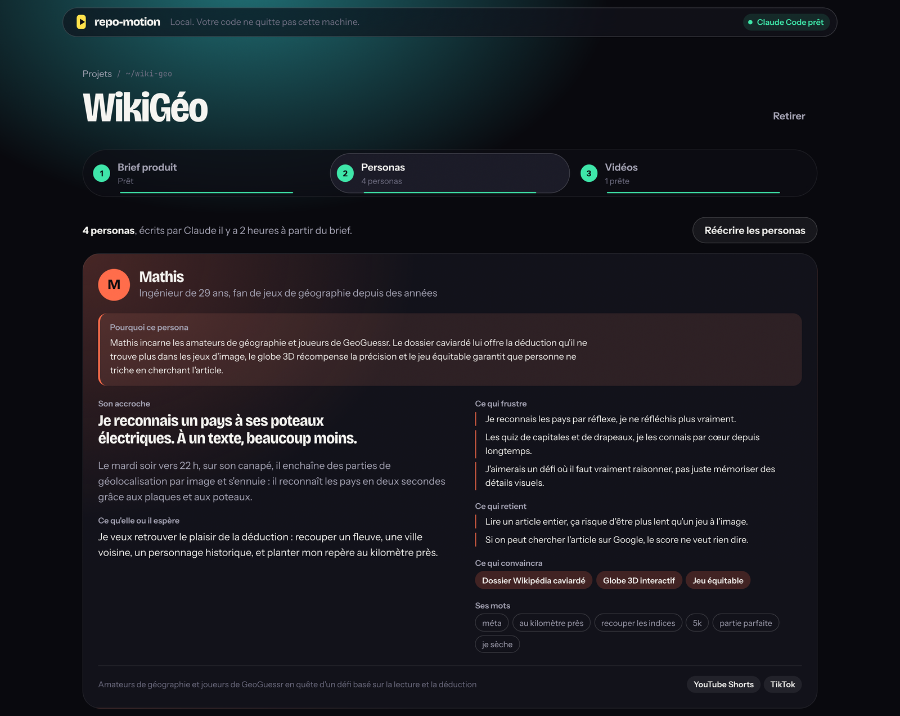
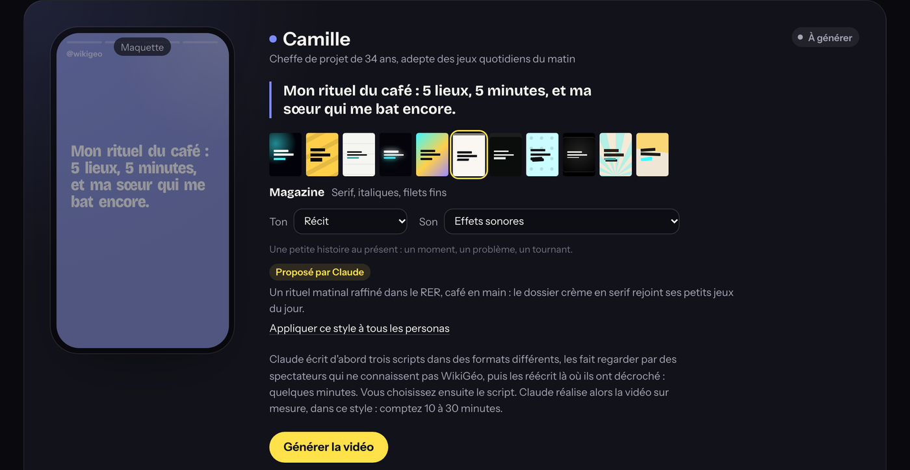
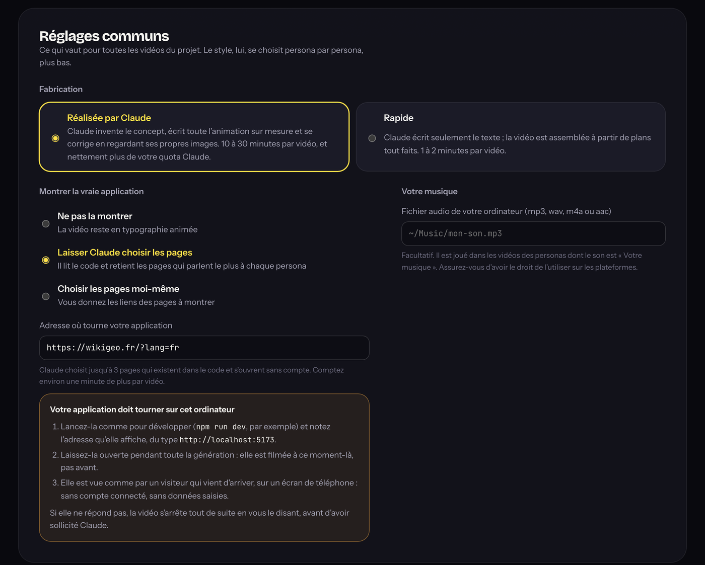
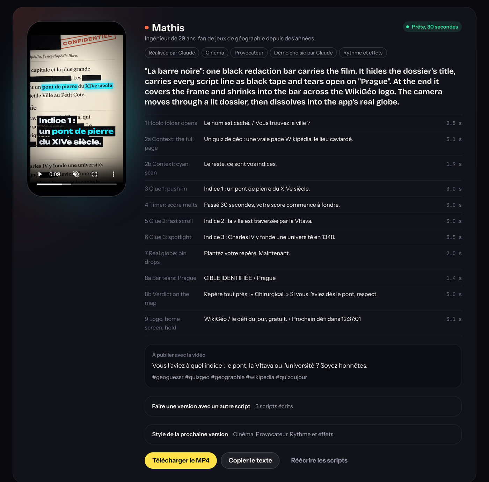

<div align="center">


# repo-motion

### Votre code devient des vidéos TikTok, Reels et Shorts.

Donnez-lui le dossier de votre application. Il comprend votre produit, trouve à qui en parler,<br/>
et réalise **une vidéo motion par audience**, aux couleurs de votre marque.

**Sur votre machine. Avec votre Claude Code. Sans compte ni serveur.**

[](LICENSE.md)
[](https://nodejs.org)
[](https://code.claude.com)
[](#)

<br/>


<sub>Quatre vidéos réalisées par repo-motion, sans retouche : trois pour le jeu <b>WikiGéo</b>, une pour repo-motion lui-même.</sub>

<br/>

[**Démarrer en 2 minutes**](#-démarrer) · [Comment ça marche](#-comment-ça-marche) · [Vie privée](#-votre-code-reste-chez-vous) · [FAQ](#-questions-fréquentes)

</div>

---

## Le problème

Vous avez construit un produit. Maintenant il faut le montrer, et les gens regardent des vidéos verticales de 20 secondes.

Un motion designer coûte cher et attend un brief. Un outil de montage demande des heures. Une IA de vidéo générique ne sait pas ce que fait votre application, ni à qui elle s'adresse.

**repo-motion part de la seule source qui dit vrai sur votre produit : son code.**

## Ce que vous obtenez

<table>
<tr>
<td width="33%" valign="top">

### 🎯 Une vidéo par audience

Pas une vidéo générique : une vidéo écrite pour chaque persona, avec son accroche, ses mots, ses frustrations.

</td>
<td width="33%" valign="top">

### 🎬 Réalisée, pas assemblée

Claude écrit l'animation sur mesure, regarde ses propres images et se corrige, comme un motion designer.

</td>
<td width="33%" valign="top">

### 🎨 À vos couleurs

Logo, palette et typographie sont lus dans votre code. Vos vraies pages peuvent apparaître à l'écran.

</td>
</tr>
<tr>
<td valign="top">

### ✍️ Des scripts testés

Chaque script est montré « à froid » à un spectateur qui ne connaît pas le produit, puis réécrit là où il a décroché.

</td>
<td valign="top">

### 🔒 100 % local

Pas de compte, pas de clé API à coller, pas de serveur tiers. Votre code ne quitte pas votre ordinateur.

</td>
<td valign="top">

### 📱 Prêt à publier

MP4 vertical 1080 × 1920, zones sûres respectées, son inclus, texte et hashtags de publication fournis.

</td>
</tr>
</table>

---

## ✨ Comment ça marche

### 1. Ajoutez un dossier

Tapez le chemin de votre application : repo-motion suggère les dossiers pendant la frappe. Lancé depuis votre projet, il le propose même tout seul.



### 2. Claude lit votre code et écrit le brief produit

En lecture seule, Claude parcourt votre code et en tire l'essentiel : ce que fait le produit, le problème qu'il résout, pour qui, ses fonctionnalités clés, ses parcours utilisateurs et son identité visuelle. Vous voyez en direct les fichiers qu'il consulte.



### 3. Il imagine vos personas

À partir du brief, Claude décrit les personnes à qui parler : leur quotidien, ce qui les frustre, ce qui les retient, ce qui les convaincra, et leurs propres mots. Chaque persona explique de quelle audience et de quelles fonctionnalités il découle.



### 4. Choisissez un style par persona

Claude propose un style différent pour chaque persona, avec la raison de son choix. Vous gardez la main sur tout :

- **11 directions artistiques** : Marque, Impact, Épuré, Néon, Dégradé, Magazine, Terminal, Pop, Cinéma, Rétro, Collage.
- **17 tons** : Complice, Expert, Drôle, Pushy, POV, Provocateur, Défi, Pédagogue, Premium, Gen Z, Bande-annonce… Le ton change la façon de dire, jamais les faits.
- **Son** : effets sonores, rythme et effets synthétisés localement (aucune licence à gérer), ou votre propre musique.



Deux réglages valent pour tout le projet : **réalisée par Claude** (sur mesure, 10 à 30 minutes) ou **rapide** (plans tout faits, 1 à 2 minutes), et la possibilité de **filmer votre vraie application** : repo-motion l'ouvre comme un téléphone et Claude choisit les pages qui parlent le plus à chaque persona.



### 5. Récupérez vos vidéos

Claude écrit trois scripts dans des formats différents, les fait relire par un spectateur qui ne connaît pas le produit, et les réécrit. Vous choisissez, retouchez un mot si besoin, et la vidéo se réalise. Il ne reste qu'à télécharger le MP4 et copier le texte de publication.



---

## 🚀 Démarrer

### Ce qu'il vous faut

| | Outil | Pour quoi faire |
| --- | --- | --- |
| ☑️ | [**Git**](https://git-scm.com/downloads) | Récupérer repo-motion depuis GitHub |
| ☑️ | [**Node.js 24+**](https://nodejs.org) | Faire tourner l'application |
| ☑️ | **pnpm** | Installer les dépendances : `corepack enable` suffit, il est fourni avec Node |
| ☑️ | [**Claude Code**](https://code.claude.com/docs/en/setup) | Le cerveau : installé **et connecté** (`claude auth login`) |
| ☑️ | Un abonnement Claude **ou** une clé API Anthropic | Ce que consomme Claude Code, comme quand vous l'utilisez vous-même |
| ➕ | Votre application qui tourne en local | Facultatif, seulement pour la filmer dans les vidéos |

Testé sur macOS. Linux devrait fonctionner ; Windows n'a pas encore été essayé, les retours sont bienvenus.

### Installer

```bash
git clone https://github.com/fchancel/repo-motion.git
```

```bash
cd repo-motion
```

```bash
corepack enable && pnpm install
```

### Lancer

**Le plus simple :** depuis le dossier de repo-motion,

```bash
pnpm dev
```

Ouvrez **http://localhost:3000**, collez le chemin de votre application (par exemple `~/Projects/mon-app`), puis cliquez sur **Ajouter le projet**. C'est tout.

<details>
<summary><b>Autre façon : lancer repo-motion depuis le dossier de votre application</b></summary>
<br/>

Construisez repo-motion une fois :

```bash
pnpm build
```

Puis, depuis le dossier de l'application à mettre en vidéo :

```bash
node ~/chemin/vers/repo-motion/bin/repo-motion.mjs
```

Le navigateur s'ouvre tout seul sur **http://localhost:4477**, avec ce dossier déjà proposé comme premier projet. C'est la version optimisée, plus rapide à démarrer : pensez à relancer `pnpm build` après chaque `git pull`.

Pour l'avoir partout, créez un alias :

```bash
echo 'alias repo-motion="node ~/chemin/vers/repo-motion/bin/repo-motion.mjs"' >> ~/.zshrc
```

</details>

> ℹ️ Le tout premier rendu télécharge une seule fois le navigateur sans interface utilisé pour dessiner les vidéos (environ 90 Mo).

### Configurer (facultatif)

repo-motion fonctionne sans aucune configuration. Pour changer le modèle, le dossier de données ou les durées maximales, copiez le modèle de configuration à la racine du dépôt :

```bash
cp .env.example .env
```

Décommentez ensuite les lignes voulues. Le fichier est lu par les deux façons de lancer. Toutes les options sont décrites dans [.env.example](.env.example).

### Combien de temps ?

| Étape | Durée |
| --- | --- |
| Brief produit | quelques minutes |
| Personas | environ 1 minute |
| Scripts | quelques minutes par vidéo |
| Vidéo **réalisée par Claude** | 10 à 30 minutes |
| Vidéo **rapide** | 1 à 2 minutes |

Deux vidéos se produisent en même temps, les autres attendent leur tour. Vous pouvez fermer l'onglet : le travail continue.

---

## 🔒 Votre code reste chez vous

repo-motion a été conçu pour que vous puissiez le lancer sur du code privé sans y réfléchir à deux fois.

- **Aucun serveur repo-motion.** Tout tourne sur votre ordinateur. Votre code n'est lu que par votre Claude Code, qui parle à Anthropic exactement comme quand vous l'utilisez au quotidien. Seules les polices de l'interface sont chargées depuis Google Fonts.
- **Aucun identifiant manipulé.** repo-motion lance le Claude Code que vous avez installé, avec votre connexion. Il ne voit ni mot de passe, ni clé.
- **Lecture seule pendant l'analyse.** Claude ne peut que lire votre dossier : ni écrire, ni exécuter, ni télécharger. Les hooks, réglages et serveurs MCP du projet analysé ne sont pas chargés.
- **Réalisation cloisonnée.** Quand Claude réalise une vidéo, il travaille dans un dossier dédié, sans réseau, et ne peut lancer que les deux commandes qui dessinent ses images.
- **Rien n'est cru sur parole.** Chaque brief, persona, script et storyboard est vérifié par des règles strictes avant d'être accepté : une fonctionnalité citée doit exister, une accroche doit tenir en 3 secondes, un texte doit rester assez longtemps à l'écran pour être lu.
- **Accessible uniquement depuis votre machine.** Le serveur n'écoute que sur `localhost` et refuse les requêtes venant d'autres sites.

Envie de tous les détails ? Voir [comment fonctionne repo-motion](docs/fonctionnement.md).

---

## ❓ Questions fréquentes

<details>
<summary><b>Combien ça coûte ?</b></summary>
<br/>

repo-motion est gratuit. Il utilise votre Claude Code, donc votre abonnement Claude ou votre clé API. Une vidéo **réalisée par Claude** consomme nettement plus de quota qu'une vidéo **rapide** : commencez par le mode rapide pour tester.

</details>

<details>
<summary><b>Quels projets peut-il analyser ?</b></summary>
<br/>

N'importe quel dossier de code : application web, mobile, API, CLI, bibliothèque… Plus le produit a une interface visible, plus les vidéos auront de matière. Pour montrer de vraies captures, l'application doit tourner en local pendant la génération (`npm run dev`, par exemple).

</details>

<details>
<summary><b>Dans quelle langue sont les vidéos ?</b></summary>
<br/>

Dans celle de votre produit : Claude écrit le brief, les personas et les scripts dans la langue de l'application qu'il analyse.

</details>

<details>
<summary><b>Puis-je utiliser les vidéos pour un produit commercial ?</b></summary>
<br/>

Oui. Les vidéos vous appartiennent : publiez-les, sponsorisez-les, monétisez-les. Vérifiez seulement que vous avez le droit d'utiliser la musique si vous ajoutez la vôtre. La licence interdit uniquement de faire de repo-motion lui-même un produit concurrent (voir [Licence](#-licence)).

</details>

<details>
<summary><b>Puis-je modifier un script ou un style ?</b></summary>
<br/>

Oui, à chaque étape. Vous choisissez parmi trois scripts, vous pouvez en changer les mots, et chaque style proposé par Claude est modifiable. Une vidéo terminée peut être refaite avec un autre script ou un autre style, sans tout réécrire.

</details>

<details>
<summary><b>Est-ce que ça génère des images ou une voix off ?</b></summary>
<br/>

Non, volontairement. Tout ce qu'on voit est dessiné par le code de l'animation ou vient de votre produit (logo, police, captures), et le son est synthétisé localement. Pas d'image inventée, pas de visage artificiel, rien à télécharger.

</details>

<details>
<summary><b>Puis-je le configurer ?</b></summary>
<br/>

Rien n'est obligatoire. Copiez `.env.example` en `.env` à la racine du dépôt pour changer le dossier de données (par défaut `~/.repo-motion`), le chemin de `claude`, le modèle utilisé, les durées maximales de chaque étape ou le port. Une variable définie dans votre terminal l'emporte sur le fichier.

</details>

---

## 🤝 Contribuer

Les contributions sont les bienvenues : signalement de bug, nouvelle direction artistique, nouveau ton, amélioration de l'interface…

```bash
pnpm dev      # lance repo-motion en développement sur http://localhost:3000
```

```bash
pnpm check    # lint + typecheck + tests, à faire passer avant chaque pull request
```

L'architecture (hexagonale, vérifiée par ESLint), les conventions et la façon de tester sont décrites dans [CONTRIBUTING.md](CONTRIBUTING.md).

---

## 📄 Licence

repo-motion est distribué sous la **[PolyForm Shield License 1.0.0](LICENSE.md)**.

**Servez-vous de repo-motion pour faire vos vidéos, même pour un produit payant. Mais ne vous en servez pas pour faire un repo-motion concurrent.**

| ✅ Autorisé | ❌ Interdit sans accord |
| --- | --- |
| Faire des vidéos pour vos projets, perso ou commerciaux, et les monétiser | Revendre repo-motion, un fork ou une version renommée |
| L'utiliser au travail, en freelance, en agence, en entreprise | En faire un service (SaaS, API, extension, appli) qui fait la même chose, **même gratuit** |
| Lire le code, l'étudier, le modifier, le forker | Distribuer un fork présenté comme une alternative à repo-motion |
| Proposer vos améliorations par pull request | Reprendre son code dans un produit concurrent |

Un doute sur votre cas, ou besoin d'une autre licence ? Ouvrez une issue, on en discute.

<sub>Au sens strict de l'[Open Source Initiative](https://opensource.org/osd), une licence qui limite certains usages n'est pas « open source » mais *source-available* : le code est public et libre d'usage, sauf pour concurrencer le projet.</sub>

<sub>Le rendu vidéo s'appuie sur [Remotion](https://www.remotion.dev), qui a sa [propre licence](https://www.remotion.dev/license) : gratuite pour les particuliers et les entreprises de trois personnes au plus, payante au-delà. Claude et Claude Code sont des produits d'Anthropic ; repo-motion n'est pas affilié à Anthropic.</sub>

---

<div align="center">

**Si repo-motion vous fait gagner du temps, laissez-lui une ⭐ : c'est ce qui aide le plus le projet à se faire connaître.**

</div>
